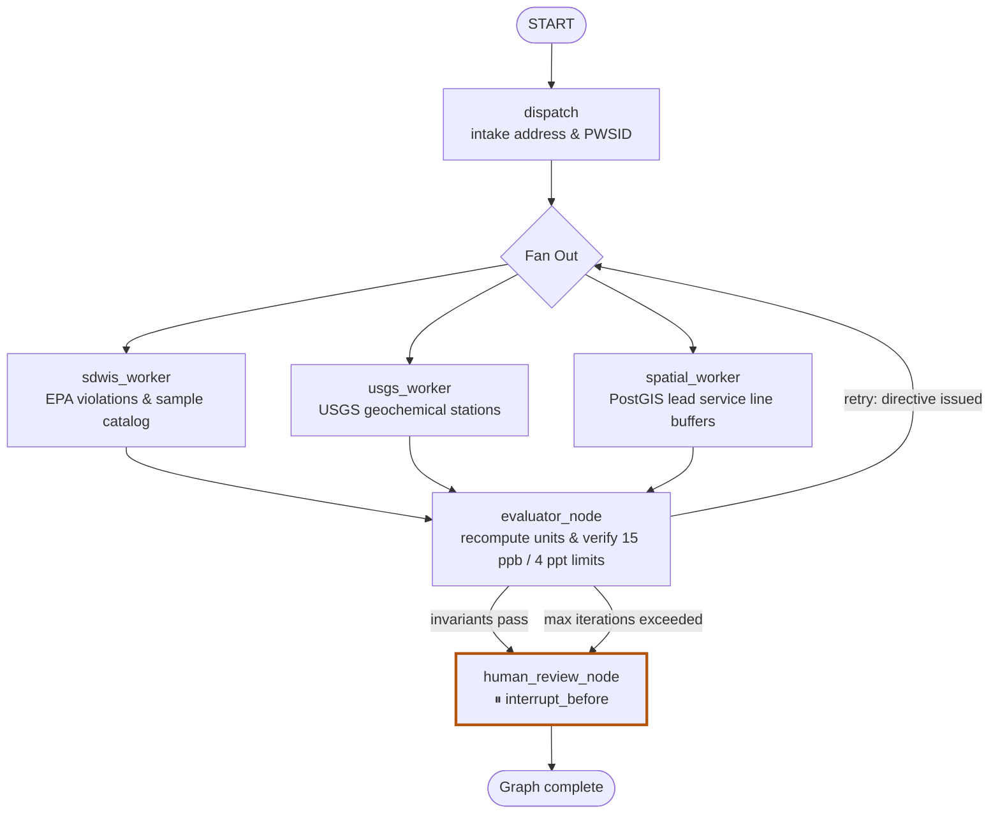
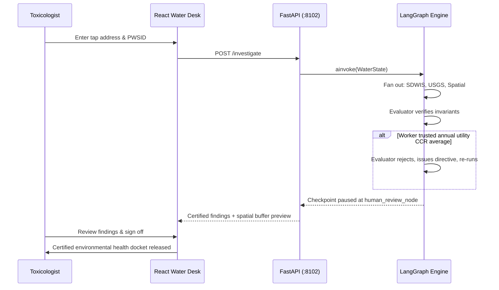
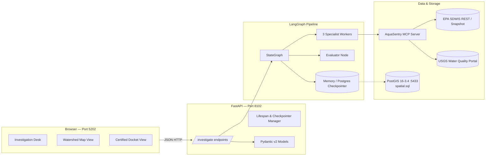

# AquaSentry

**A deterministic hydro-toxicology and drinking water sentinel — with a toxicologist still in the loop.**

Millions of families and schoolchildren still drink from aging lead service lines, and toxic PFAS "forever chemicals" contaminate municipal water systems at parts-per-trillion levels. Annual utility Consumer Confidence Reports (CCRs) smooth over these dangers by averaging chemical samples across an entire municipality over twelve months — allowing an elementary school drinking fountain to sit directly at or above the 15 ppb Lead and Copper Rule action level while the annual report declares city water "acceptable". AquaSentry is software I built to audit municipal water systems from raw tap samples: enforce strict unit conversions without floating-point errors, reject utility averaging, join municipal pipe inventories to parcel school coordinates using PostGIS buffer intersections, and compile an evidentiary docket for a public health reviewer to certify.

This repo is the full monorepo: typed data contracts, a cyclic LangGraph multi-agent pipeline, an MCP open-data tools catalog, a FastAPI backend, and an organic, water-themed React desk interface where toxicologists sign off before findings are released.

---

## Environmental showcase

These are the operational screens from the local interface running against the Newark, New Jersey watershed fixture (**PWSID `NJ0714001`**, Lower Passaic watershed, Louise A. Spencer School sample site).

```
+----------------------------------------------------------------------------------------------------+
| AQUASENTRY // HYDRO-TOXICOLOGY SENTINEL // PWSID: NJ0714001                    [STATUS: CERTIFIED]  |
+----------------------------------------------------------------------------------------------------+
| [WATERSHED & HYDROLOGY]             | [TOXICOLOGICAL SAMPLING // LOUISE A. SPENCER SCHOOL]         |
| System:    Newark Water Dept        | Analyte: Lead (Pb)                                           |
| Watershed: Lower Passaic / Newark   | Reported:  15.0 ppb (0.015 ppm)                              |
| USGS Stn:  01389005 (HUC-12)        | LCR Limit: 15.0 ppb Action Level (40 CFR § 141.80)           |
| pH / Alk:  6.6 pH // 28 mg/L Alk    | Utility Claim: "SAFE" (Based on citywide annual CCR average) |
| Corrosivity Index: AGGRESSIVE       | Evaluator Finding: [VIOLATION CONFIRMED - CCR DISMISSED]     |
+----------------------------------------------------------------------------------------------------+
| [PFAS CONTAMINANT MONITORING]       | [POSTGIS SPATIAL EXPOSURE // 50-METER BUFFER]                |
| Analyte: PFOA (Perfluorooctanoic)   | Line ID:   LSL-1842                                          |
| Reported:  6.2 ppt (Wanaque intake) | Material:  LEAD SERVICE LINE                                 |
| MCL Limit: 4.0 ppt (EPA UCMR 5)     | Target:    Louise A. Spencer School                          |
| Evaluator Finding: [MCL EXCEEDED]   | Distance:  5.2 meters [DIRECT BUFFER INTERSECTION CONFIRMED] |
+----------------------------------------------------------------------------------------------------+
```

The frontend provides a multi-step investigation desk ([`apps/web/src/components/Desk.tsx`](apps/web/src/components/Desk.tsx)), an interactive watershed layer viewer ([`apps/web/src/components/WatershedMap.tsx`](apps/web/src/components/WatershedMap.tsx)), a transparent statutory method reference ([`apps/web/src/components/Method.tsx`](apps/web/src/components/Method.tsx)), and a certified toxicological docket viewer ([`apps/web/src/components/Docket.tsx`](apps/web/src/components/Docket.tsx)).

---

## What makes AquaSentry different

Most consumer "water quality" websites display generic postal code lookups that regurgitate annual utility marketing blurbs. AquaSentry treats hydro-toxicology as an adversarial audit where utility averages cannot override point-of-use laboratory measurements.

| | Generic Water Apps / Chatbots | AquaSentry |
|---|---|---|
| **Regulatory Baseline** | Annual municipal utility CCR averages | Strict **tap-level evaluation** against **40 CFR § 141.80** (LCR) and **EPA UCMR 5** (PFAS) |
| **Unit Arithmetic** | Naive float conversions or unit blindness | Canonical **integer / parts-per-billion & parts-per-trillion conversion** (`ppb`, `ppt`, `µg/L`, `mg/L`) |
| **Exposure Mapping** | Interpolated "plume" approximations | Exact **PostGIS buffer intersections** between verified lead service lines and sensitive school properties |
| **Multi-Agent Pipeline** | Unchecked single-prompt LLM summaries | **LangGraph cyclic multi-agent graph** with an independent actuarial evaluator node |
| **Public Health Control** | Auto-generates unfiltered notices | **Hard pause before final docket**; status `human_review` if invariants fail or iterations exhaust |
| **Data Resilience** | Fragile dependencies on EPA servers | **2,500 ms SLA timeout** with automatic fallback to high-fidelity local SDWIS snapshots |

Under the hood, worker agents gather and map hydrological findings, but the evaluator re-computes all toxicological thresholds and spatial buffer intersections deterministically before a human signs off.

---

## Computational skills this project shows best

### 1. Chemical unit conversion & invariant gates
- **Strict canonical unit normalization**: converts and verifies concentrations across `ppb`, `ppm`, `mg/l`, `µg/l`, and `ppt` without rounding drift ([`packages/agents/src/aquasentry_agents/invariants.py`](packages/agents/src/aquasentry_agents/invariants.py)).
- **Zero tolerance for utility CCR averaging**: if a raw sample registers at or above 15.0 ppb for lead or 4.0 ppt for PFOA/PFOS, the evaluator rejects any worker classification of "safe" and enforces the statutory violation.

*Skill:* Building deterministic regulatory validation engines for environmental toxicological data.

### 2. Spatial analysis with PostGIS buffer intersections
- **Geographic point-to-line buffer queries**: joins municipal lead service line (LSL) geometry with educational parcel centroids in SQL ([`packages/agents/src/aquasentry_agents/spatial.sql`](packages/agents/src/aquasentry_agents/spatial.sql)).
- Rejects ungrounded LLM "interpolated plumes" — an exposure hazard is certified if and only if a documented lead service line intersects the school's spatial buffer.

*Skill:* Executing spatial database queries and computational geometry for environmental risk modeling.

### 3. Cyclic multi-agent orchestration (LangGraph)
- **Parallel worker fan-out**: `sdwis_worker`, `usgs_worker`, and `spatial_worker` execute concurrently via LangGraph's `Send` API ([`packages/agents/src/aquasentry_agents/graph.py`](packages/agents/src/aquasentry_agents/graph.py)).
- **Explicit channel reducers**: state channels employ `replace` for domain sub-states, append-only for `audit_trail`, and list concatenation for `rejection_vector` ([`packages/agents/src/aquasentry_agents/state.py`](packages/agents/src/aquasentry_agents/state.py)).
- Durable Postgres checkpointer integration for persistent workflow state across service lifecycles.

*Skill:* Architecting multi-worker state graphs with clean fan-out/fan-in topologies and typed channel reducers.

### 4. Evaluator–optimizer reflection with bounded retries
- The evaluator node treats worker outputs as untrusted and independently re-verifies chemical units, statutory thresholds, and buffer distances ([`packages/agents/src/aquasentry_agents/evaluator.py`](packages/agents/src/aquasentry_agents/evaluator.py)).
- Emits structured `re_evaluation_directive` instructions when workers uncritically accept utility CCR averages, driving targeted self-correction.
- Bounded to `MAX_ATTEMPTS = 3`; fails closed into `human_review` if convergence fails rather than looping infinitely.

*Skill:* Designing reflection and self-correction loops with deterministic termination guarantees.

### 5. Resilient open-data architecture & MCP integration
- Tool catalog implementing standardized interfaces to the EPA Safe Drinking Water Information System (SDWIS) and USGS Water Quality Portal ([`packages/mcp_tools/src/aquasentry_mcp/catalog.py`](packages/mcp_tools/src/aquasentry_mcp/catalog.py)).
- Strict **2,500 ms SLA timeout** on EPA REST queries with automatic fallback to high-fidelity Newark snapshot fixtures, preserving data source lineage.

*Skill:* Designing fault-tolerant ingestion pipelines against erratic government web services.

### 6. Full-stack product engineering
- High-performance FastAPI service with Pydantic request validation and async lifecycle management ([`packages/api/src/aquasentry_api/main.py`](packages/api/src/aquasentry_api/main.py)).
- Responsive React 19 interface with Tailwind CSS, custom water-themed organic aesthetics ("FloatingOrganic"), noise overlays, and certification timelines ([`apps/web/src/`](apps/web/src/)).
- 15 automated pytest tests covering invariant chemical math, spatial buffer calculations, cyclic graph convergence, and API validation.

*Skill:* Delivering production-ready environmental public health interfaces backed by deterministic Python agent pipelines.

---

## At a glance

| Dimension | Specification |
|---|---|
| **Public Water System** | Newark Water Department (`NJ0714001`) // Lower Passaic Watershed (`HUC-12 020301031204`) |
| **Hydrology Data** | USGS Station `01389005` (pH 6.6, alkalinity 28 mg/L, corrosivity index) |
| **Toxicology Rules** | 40 CFR § 141.80 (Lead & Copper Rule 15 ppb), EPA UCMR 5 (PFOA 4.0 ppt, PFOS 4.0 ppt MCL) |
| **Spatial Layer** | PostGIS lead service line inventories intersected with municipal school parcel buffers |
| **Output** | Certified statutory contaminant finding, spatial buffer verification, public health docket |
| **Guardrail** | Graph pauses before docket certification; fails closed to `human_review` on unresolved invariant errors |

---

## How an investigation moves through the system

```mermaid
stateDiagram-v2
    direction LR
    [*] --> INTAKE: Enter Address & PWSID
    INTAKE --> FAN_OUT: Dispatch workers
    state FAN_OUT {
        direction TB
        SDWIS_WORKER: SDWIS Worker (EPA Violations & CCR)
        USGS_WORKER: USGS Worker (Hydrology & Corrosivity)
        SPATIAL_WORKER: Spatial Worker (PostGIS LSL Buffers)
    }
    FAN_OUT --> EVALUATING: Converge state
    EVALUATING --> FAN_OUT: Invariant breach & iterations < 3
    EVALUATING --> HUMAN_REVIEW: Invariants fail & iterations >= 3 (fail-closed)
    EVALUATING --> AWAITING_TOXICOLOGIST: Invariants pass
    AWAITING_TOXICOLOGIST --> CERTIFIED: Toxicologist signs off
    CERTIFIED --> [*]
    HUMAN_REVIEW --> [*]
```



---

## The agent pipeline (LangGraph)

AquaSentry uses a cyclic graph architecture where workers formulate initial findings and an evaluator enforces regulatory ground truth.



### Verification sequence



---

## Architecture



---

## What the evaluator actually checks

| Category | Regulatory Standard | Exact Invariant Rule |
|---|---|---|
| **Lead Action Level** | 40 CFR § 141.80 (LCR) | Raw lead >= `15.0 ppb` (or `0.015 ppm`, or `15 µg/L`). Rejects utility CCR averages claiming compliance. |
| **PFAS Maximum Contaminant Level** | EPA UCMR 5 / SDWA | PFOA >= `4.0 ppt` or PFOS >= `4.0 ppt` constitutes an immediate Maximum Contaminant Level violation. |
| **Spatial Hazard Grounding** | PostGIS Buffer Intersection | Lead service lines must intersect parcel boundary within 50-meter buffer. Interpolated plumes are forbidden. |
| **Geochemical Corrosivity** | USGS Station Hydrology | Evaluates water aggressiveness using pH and alkalinity indices to determine leaching potential. |

If invariant errors persist after 3 cycles, the graph terminates into `human_review` with an explicit `rejection_vector`.

---

## Tech Stack

| Layer | Technologies |
|---|---|
| **Frontend** | React 19, TypeScript, Vite, Tailwind CSS, Lucide Icons, Radix UI primitives, Custom Organic water styling |
| **API** | FastAPI, Pydantic v2, Uvicorn, structured HTTP error handling |
| **Agents & Workflow** | LangGraph `StateGraph`, `Send` API fan-out, custom channel reducers, checkpoint persistence |
| **Tooling & MCP** | Model Context Protocol (`aquasentry_mcp`), EPA / USGS JSON fixtures, `uv`, `pytest`, `ruff`, `mypy` |
| **Spatial & Storage** | PostGIS 16-3.4 (port `5433`) via Docker Compose, spatial SQL schema ([`spatial.sql`](packages/agents/src/aquasentry_agents/spatial.sql)) |

---

## Try it locally

### 1. Environment & PostGIS Database

```bash
# Start PostGIS 16 (port 5433) with spatial.sql auto-loaded
docker compose up postgres -d

# Copy environment template
cp .env.example .env
```

### 2. Run backend & frontend

You can use the unified dev launcher:

```bash
./scripts/dev.sh
```

Or run each service individually:

```bash
# Backend API (port 8102)
uv sync
uv run uvicorn aquasentry_api.main:app --host 127.0.0.1 --port 8102 --reload

# Frontend Web App (port 5202)
cd apps/web
npm install
npm run dev -- --port 5202
```

| Service | URL | Notes |
|---|---|---|
| **Web Interface** | http://localhost:5202 | Interactive investigation desk, watershed map, docket export |
| **API Server** | http://localhost:8102 | Interactive docs at `/docs`, health probe at `/healthz` |
| **PostGIS Database** | `localhost:5433` | Database `aquasentry`, user `aquasentry` |

---

## Web interface & routes

| Component | Purpose |
|---|---|
| **Landing** | Overview of drinking water crisis, Newark watershed case study, and instant sample auditor |
| **Investigation Desk** | Address and PWSID intake, live agent execution polling, and chemical violation cards |
| **Watershed Map** | Geographic view of USGS monitoring stations and lead service line buffer intersections |
| **Method View** | Regulatory breakdown of 40 CFR § 141.80 and EPA UCMR 5 toxicological standards |
| **Docket View** | Certified environmental health finding with public health sign-off and audit trail |

---

## Tests

The test suite covers pure invariant chemical conversions, multi-agent cyclic execution with self-correction, and FastAPI routes:

```bash
uv run pytest
```

### Test coverage breakdown:
- **`test_invariants.py` (9 tests)**: Verifies 15 ppb lead action level thresholds, unit conversions across ppb, ppm, mg/L, µg/L, and ppt, 4.0 ppt PFOA/PFOS limits, and statutory citation mapping.
- **`test_graph.py` (2 async tests)**: Verifies that the evaluator rejects utility CCR averaging on iteration 0, forces self-correction to raw sample truth on iteration 1, and fails closed into `human_review` when a utility average is forced.
- **`test_api.py` (4 tests)**: Tests `/healthz`, successful investigation certification via the API, 422/404 handling on unknown PWSIDs, and input validation on short addresses.

---

## Repository map

```
AquaSentry/
├── apps/
│   └── web/                   React 19 + Vite environmental health desk
│       ├── src/components/    Desk, Docket, Landing, Method, WatershedMap, CertificationPath
│       └── src/lib/           API client, chemical formatting, theme hooks
├── packages/
│   ├── agents/                LangGraph agent implementation
│   │   └── src/aquasentry_agents/
│   │       ├── invariants.py  Chemical unit conversion & toxicological threshold gates
│   │       ├── spatial.py     PostGIS buffer queries & vulnerability scoring
│   │       ├── spatial.sql    PostGIS 16 database initialization schema
│   │       ├── state.py       WaterState TypedDict with custom reducers
│   │       ├── workers.py     SDWIS, USGS, and spatial worker nodes
│   │       ├── evaluator.py   Deterministic toxicological evaluator node
│   │       └── graph.py       StateGraph compilation & interrupt routing
│   ├── api/                   FastAPI service layer
│   │   └── src/aquasentry_api/
│   │       └── main.py        Investigation endpoints, lifespan checkpointer, Pydantic schemas
│   └── mcp_tools/             Model Context Protocol tools & data fixtures
│       └── src/aquasentry_mcp/
│           ├── catalog.py     EPA SDWIS / USGS catalog with 2500ms fallback
│           └── fixtures/      Newark, NJ water department fixture (NJ0714001)
├── docs/
│   └── blueprint.pdf          Original architectural specification
├── scripts/
│   └── dev.sh                 Unified development launcher
├── tests/                     Complete pytest test suite (15 tests)
├── docker-compose.yml         PostGIS 16 container definition
└── pyproject.toml             uv workspace root configuration
```

---

## Why I built this

When public utilities average water quality results over annual reporting cycles, localized crises become invisible. Children in older school facilities drink water from lead-lined fixtures while utility reports report high citywide compliance.

I built AquaSentry to enforce accountability at the specific tap where a person actually drinks. By pairing multi-agent open-data ingestion with deterministic toxicological gates and PostGIS spatial buffer intersections, AquaSentry ensures that environmental health findings are backed by statutory citations and mathematical certainty.

---

<p align="center">
  <sub>Built with care for communities fighting for clean, transparent drinking water.</sub>
</p>
