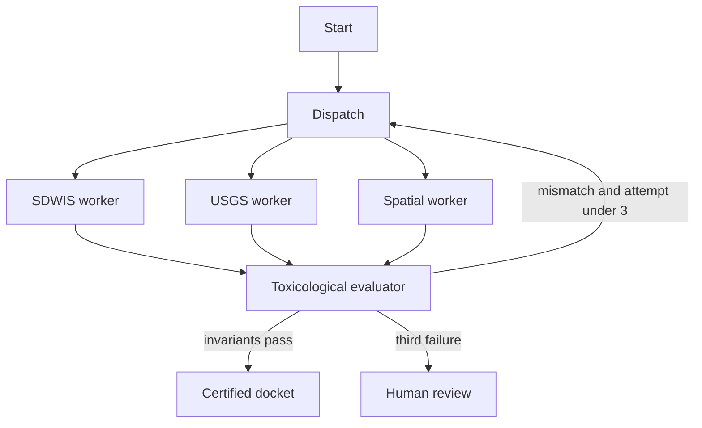

# AquaSentry

Hydro-toxicology sentinel for one watershed: Newark, New Jersey (`NJ0714001`). Residents and school staff can check a tap against the Lead and Copper Rule action level and the PFOA/PFOS maximum contaminant level. The evaluator does the arithmetic. A utility Consumer Confidence Report average cannot mark a 15 ppb lead sample as safe.

This repository is the 4-week scaffold from the civic multi-agent blueprint, not a statewide ingestion product. The blueprint PDF is in [`docs/blueprint.pdf`](docs/blueprint.pdf).

## Crisis

Millions of people still drink from unreplaced lead service lines, and PFAS shows up in public systems at parts-per-trillion. Annual water reports average those results across a city, so a school fountain can sit at the action level while the report reads as acceptable. Private lab tests cost hundreds of dollars a sample.

## Open-data anchors

| Source | Endpoint | What this scaffold does |
| --- | --- | --- |
| EPA SDWIS | `https://data.epa.gov/efservice/` | Local snapshot. A live call that exceeds 2,500 ms falls back to that snapshot and keeps the snapshot date. |
| USGS Water Quality Portal | `https://www.waterqualitydata.us/` | Fixture pH and alkalinity for HUC-12 `020301031204`. |
| EPA UCMR 5 | `https://www.epa.gov/dwucmr/` | Fixture PFOA 6.2 ppt and PFOS 3.1 ppt. |
| Lead and Copper Rule inventories | Municipal GeoJSON | Three fixture service lines. Buffer intersection only. |

Live EPA, USGS, and UCMR pulls are not wired to production keys. `AQUASENTRY_LIVE_EPA` is reserved in `.env.example`.

## Architecture



The first SDWIS pass repeats the utility's "safe" flag. The evaluator recomputes:

- Lead at or above 15 ppb violates 40 CFR 141.80. Fifteen ppb is a violation.
- PFOA and PFOS above 4.0 ppt violate 40 CFR 141.61. Exactly 4.0 ppt does not.
- Units convert before comparison (`ug/L` = ppb, `ng/L` = ppt).
- School exposure is a buffer around known lead lines (`ST_DWithin` in PostGIS, haversine stub in Python). The graph does not interpolate a plume.

On the Newark fixture the first pass fails, the workers recompute, and the docket certifies. If a worker is stuck on the utility flag, the third failure exits to human review.

`AsyncPostgresSaver` is created in the FastAPI lifespan when `DATABASE_URL` is set. Without it, the process uses an in-memory checkpointer so tests and a laptop demo still run. Postgres tables (`checkpoints`, `checkpoint_blobs`, `checkpoint_writes`) are created by `saver.setup()`.

## Failure mode

SDWIS often times out or returns an empty state extract. `fetch_sdwis` uses a 2,500 ms timeout. On timeout or HTTP error it reads the local mirror and sets `data_source` to `snapshot` with `fallback_reason=epa_timeout_or_error`. The docket prints that snapshot date.

## 4-week MVP checklist

- [x] Single watershed fixture (Newark / `NJ0714001`)
- [x] Three workers and a bounded evaluator loop
- [x] PostGIS `service_lines_within` SQL, applied on first database init
- [x] React map: lead red, copper green, unknown amber
- [x] Petition draft citing 40 CFR 141.85
- [ ] Replace the fixture with a real SDWIS violation extract and a city lead-line GeoJSON
- [ ] Run inverse-distance queries only if a sampled station exists inside the buffer; still no invented plumes
- [ ] Add EPA and USGS API credentials and alert when the mirror is older than the utility's last CCR

## Run

```bash
cp .env.example .env
docker compose up -d
uv sync
uv run pytest
./scripts/dev.sh
```

API: `http://127.0.0.1:8102/health`  
UI: `http://127.0.0.1:5202`

```bash
curl -s http://127.0.0.1:8102/health
curl -s -X POST http://127.0.0.1:8102/investigations \
  -H 'content-type: application/json' \
  -d '{"address":"81 Congress St, Newark, NJ","pwsid":"NJ0714001"}'
```

Python dependencies are managed only with `uv`. The web app is Vite, React, and Tailwind. MCP tools live in `packages/mcp_tools` (`aquasentry-mcp` on stdio).

## Secrets

Do not commit `.env`. GitHub Actions secrets to add later, not stored here:

- `DATABASE_URL` for a hosted Postgres with PostGIS
- `EPA_API_KEY` if a future Envirofacts path requires one

## Layout

`packages/api` FastAPI, `packages/agents` LangGraph, `packages/mcp_tools` fixtures and FastMCP, `apps/web` dashboard, `tests` invariant and graph tests.
